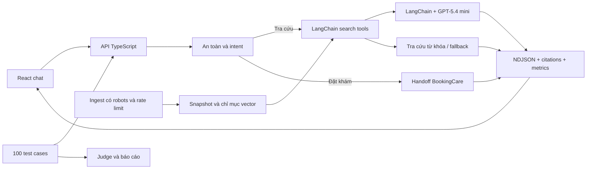

# Trợ lý đi khám

Bài sơ khảo Fullstack Engineer – AI Product Builder. Giao diện React hỗ trợ tra cứu bác sĩ, chuyên khoa, cơ sở y tế, dịch vụ và FAQ từ các trang công khai của BookingCare. Người dùng tiếp tục chọn và xác nhận lịch trên BookingCare.

## Chạy sau khi clone

Yêu cầu Node.js 24+ và npm. Repo đi kèm [KB BookingCare](data/bookingcare.json) và [chỉ mục vector](data/vectors.json) khớp với nhau. Có thể chạy ngay từ bản dữ liệu đã đóng gói.

```powershell
npm ci
Copy-Item .env.example .env
# Điền OPENAI_API_KEY của bạn vào .env
npm run dev
```

Mở http://127.0.0.1:4173. Hybrid RAG bắt buộc có `OPENAI_API_KEY` phía server để tạo embedding cho câu hỏi và sinh câu trả lời. Nếu thiếu key, server dừng ngay khi khởi động và báo cách cấu hình. Endpoint `/api/health` báo `mode: "model"` và `retrieval: "hybrid"`. Để chạy bản build, dùng `npm run build` và `npm start`. [OpenAI Docs – xác thực API](https://developers.openai.com/api/reference/overview#authentication).

## Triển khai trên Vercel

Import repo vào Vercel, chọn `main` làm nhánh Production và đặt `OPENAI_API_KEY` trong Environment Variables của Production. Có thể đặt thêm `CHAT_MODEL` và `CHAT_REASONING_EFFORT` theo `.env.example`. `vercel.json` build giao diện Vite vào `dist` và đóng gói hai file dữ liệu cùng Express API. Sau khi deploy, kiểm tra `/api/health` rồi gửi một câu hỏi tra cứu từ giao diện để xác nhận chat hoạt động.

## Bật AI và chạy đánh giá

1. Chạy app ở chế độ mặc định với key có quyền gọi các model GPT‑5.4.
2. Trong terminal thứ hai, chạy `npm run eval -- --limit=3` để kiểm tra quyền model, sau đó chạy `npm run eval` cho đủ 100 ca. Cả hai lệnh gọi OpenAI API và phát sinh phí.
3. Đọc báo cáo Markdown và JSON trong `reports/`. File `.raw.json` chứa từng lượt, bằng chứng, kết quả judge và lỗi. Lần chạy một phần có hậu tố `-smoke-N`. Lần chạy đầy đủ ghi đè báo cáo cùng cấu hình reasoning.

Runner ghi báo cáo trước khi trả mã lỗi nếu phát hiện lượt fallback, thiếu số đo hoặc vượt giới hạn của đề. Kiểm tra báo cáo để xem nguyên nhân và số ca đã được chấm.

Để cập nhật dữ liệu, chạy `npm run ingest`, tiếp theo `npm run embed` để lập lại chỉ mục cho snapshot mới, rồi khởi động lại server.

Mặc định assistant dùng GPT‑5.4 mini với reasoning `none`. Để tái chạy cấu hình GPT‑5.4 medium, đặt `CHAT_MODEL=gpt-5.4` và `CHAT_REASONING_EFFORT=medium` trong `.env`, khởi động lại server rồi chạy `npm run eval`. Judge dùng GPT‑5.4 với temperature 0 và reasoning `none`. [OpenAI Docs – GPT‑5.4 mini](https://developers.openai.com/api/docs/models/gpt-5.4-mini), [OpenAI Docs – GPT‑5.4](https://developers.openai.com/api/docs/models/gpt-5.4).

```powershell
npm run lint
npm run typecheck
npm test
npm run build
```

### So sánh kết quả benchmark

Hai lần chạy ngày 10/11/2026 dùng cùng 100 ca, 108 lượt chat, snapshot 73 trang, chỉ mục vector và rubric. GPT‑5.4 chấm đủ 100 ca ở mỗi lần chạy, với temperature 0 và reasoning `none`. Cả hai cấu hình trả lời có giới hạn 420 token đầu ra mỗi lần gọi model.

| Chỉ số | GPT‑5.4 mini · `none` | GPT‑5.4 · `medium` | Giới hạn đề |
| --- | ---: | ---: | ---: |
| Ca đạt rubric | 57/100 | 55/100 | |
| Latency trung bình mỗi lượt | 0,88 s | 2,21 s | ≤ 10 s |
| Latency p50 / p95 | 1,22 / 1,89 s | 2,53 / 5,88 s | |
| Token đầu vào trung bình mỗi lượt, gồm embedding | 478,34 | 479,28 | ≤ 30.000 |
| Token đầu ra trung bình mỗi lượt, gồm reasoning | 51,43 | 137,85 | ≤ 500 |
| Token đầu ra trung bình riêng lượt gọi model | 89,58 | 240,13 | |
| Lượt dùng câu trả lời dự phòng | 1 | 1 | |

Số đo latency tính từ lúc gửi request đến lúc đọc xong stream, không gồm thời gian judge. Tổng đầu vào có số đo ở 107/108 lượt trong mỗi lần chạy. Cả hai cấu hình đạt ba ngưỡng hiệu năng đo được. Trong lần chạy này, `medium` đạt ít hơn 2 ca và có latency trung bình cao hơn khoảng 2,5 lần. So sánh này thay đổi cả model và mức reasoning, nên không đo riêng tác động của từng yếu tố. Với `medium`, trung bình 141,58 token mỗi lượt gọi model dành cho reasoning và 4 lượt chạm giới hạn 420 token. [OpenAI Docs – cách tính token reasoning](https://developers.openai.com/api/docs/guides/reasoning).

[Báo cáo GPT‑5.4 mini](reports/llm-evaluation.md) · [Báo cáo GPT‑5.4 medium](reports/llm-evaluation-medium.md)

## Kiến trúc



- `src/web` chứa UI React và xử lý streaming. `src/shared` định nghĩa hợp đồng NDJSON. `src/server` chứa router, truy xuất, assistant và API.
- `scripts/ingest.ts` duyệt một số danh mục công khai đã chọn, kiểm tra robots và ngừng khi server trả 403, 429 hoặc 503. Chỉ giữ title, URL, loại, thời điểm, metadata và đoạn text cần cho tra cứu. `scripts/embed.ts` tạo vector theo hash snapshot.
- Tìm kiếm dùng IDF trên từ khóa tiếng Việt bỏ dấu và lọc loại trang, tỉnh/thành. Khi có vector tương ứng, hệ thống kết hợp cosine similarity với điểm từ khóa. Giữ tối đa bốn nguồn. Embedding quá hạn thì tiếp tục tìm từ khóa.
- Assistant có system prompt ổn định, giữ tối đa sáu tin nhắn trước, tách đoạn nguồn theo lượt hiện tại và giới hạn đầu ra provider ở 420 token. Mỗi dòng sinh ra phải tham chiếu ID đã có. Tính hợp lệ của ID không tự chứng minh từng mệnh đề được nguồn hỗ trợ, nên đánh giá có tiêu chí groundedness riêng.
- Chính sách cấp cứu, từ chối kê đơn, bàn giao đặt khám và kiểm tra giá/lịch trực tiếp chạy trước model. Handoff chỉ dùng link BookingCare từ snapshot hoặc trang tra cứu chính thức. Các tuyến đặt lịch và thanh toán bị loại khỏi crawl. [robots.txt](https://bookingcare.vn/robots.txt), [Điều khoản BookingCare](https://bookingcare.vn/trang/dieu-khoan-su-dung-i7).
- Browser giữ lịch sử trong bộ nhớ phiên. API log số đo theo lượt, không log nội dung chat. Số điện thoại, email và chuỗi định danh phổ biến được che trước khi truy xuất hoặc gọi model. Bộ che theo mẫu có thể bỏ sót dữ liệu tự do. Bản chạy local bind loopback. API giới hạn bốn lượt đồng thời trên mỗi tiến trình.
- `eval/cases.ts` chứa 100 ca và kỳ vọng. `eval/run.ts` gọi cùng API streaming với giao diện, kiểm tra hợp đồng rồi chấm từng ca bằng schema 0–4. Pass yêu cầu các kiểm tra hợp đồng đạt và mọi tiêu chí áp dụng ≥3. Điểm judge, latency và usage được báo riêng.

## Phạm vi của bản thử nghiệm

Snapshot là một phần danh mục BookingCare, ưu tiên các chuyên khoa phổ biến và một số cơ sở/dịch vụ ở Hà Nội, TP.HCM. Thông tin giá, lịch và khả năng nhận khám có thể thay đổi. Trợ lý hướng người dùng kiểm tra trang chính thức. Hiện có tích hợp OpenAI trong giới hạn đề bài.

Repo chứa mã nguồn, hai file dữ liệu công khai phục vụ demo, bộ ca thử tổng hợp và báo cáo tóm tắt. Git bỏ qua `.env` và các báo cáo raw. Dùng câu hỏi tổng hợp khi chạy eval. Khi triển khai ngoài localhost, cần rà soát quyền sử dụng dữ liệu, kiểm soát truy cập, giới hạn chi phí và đánh giá an toàn độc lập.

[Trả lời lý thuyết câu 1 và 2](docs/theory.md).
